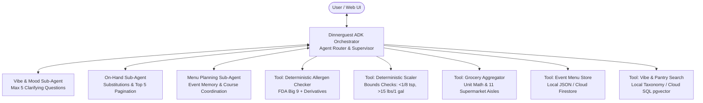

# Dinnerguest 🍽️

An orchestration-driven multi-agent culinary planning system built with the **Google Cloud Agent Development Kit (ADK)** and targeted for deployment on **Google Cloud Agent Engine** / Cloud Run.

Dinnerguest assists home cooks, hosts, and party planners through conversational recipe discovery, precise volume scaling, zero-hallucination allergen safety screening, aisle-organized grocery list generation, and multi-course event planning with long-term memory.

---

## 🏛️ System Architecture



---

## ✨ Features by Phase

1. **Deterministic Safety Engines (Phase 1)**:
   - **Allergen Checker**: Strict, rule-based FALCPA Big 9 allergen detection (Milk, Eggs, Peanuts, Tree Nuts, Wheat, Soy, Fish, Crustacean Shellfish, Sesame). Detects hidden derivatives (e.g. anchovy in Worcestershire, casein in milk, pine nuts in pesto) and flags ambiguous items.
   - **Recipe Scaler**: Proportional fraction math with culinary safety guardrails (< 1/8 tsp minimum threshold warning, > 15 lbs / > 1 gal bulk batch warnings). Formats plain text fractions (e.g., `1 1/2 cups`), strictly avoiding LaTeX formatting.

2. **On-Hand Ingredient Recommendations (Phase 2)**:
   - Constrained recipe matching with set intersection.
   - Smart culinary substitutions (e.g. shallots $\leftrightarrow$ yellow onion) and proactive staple follow-up questions.
   - Dialogue pagination: presents top 5 matches and reports remaining match count $N$.

3. **Semantic Vibe & Mood Recommendations (Phase 3)**:
   - Discovers dishes from abstract vibes ("cozy Sunday dinner", "spicy pork").
   - Strict **5-question hard guardrail**: narrows options with targeted questions and falls back politely if preferences cannot be pinpointed.
   - Automatically attaches allergen screenings to all recipe results.

4. **Consolidated Grocery List Generation (Phase 4)**:
   - Cross-recipe ingredient aggregation (e.g., combines 1 cup sugar + 0.5 cup sugar into 1.5 cups).
   - Volume and weight unit conversions (tsp $\rightarrow$ cups, oz $\rightarrow$ lbs).
   - Retail packaging notes (butter sticks, egg cartons, pasta boxes).
   - Automatic classification into 11 supermarket aisles.

5. **Menu Planning & Persistent Memory (Phase 5)**:
   - Multi-course coordination (Appetizer, Main, Side, Dessert).
   - Full CRUD event store (`save_event_menu`, `get_event_menu`, `list_event_menus`, `delete_event_menu`).
   - Automatically scales all dishes to the event guest count.
   - Computes whole-menu allergen profiles and diet-safe course indicators.

6. **Unified Deployment & Cloud Packaging (Phase 6)**:
   - Production Docker container and Cloud Run / Agent Engine configuration.
   - Cloud SQL for PostgreSQL with `pgvector` RAG schema.
   - Firestore native mode backend hook for event menus.
   - Modular deployment scripts for each service and a unified runner.

---

## 🚀 Local Development & Testing

### Prerequisites
* Python 3.10+
* Virtual environment (recommended)

### Installation
```bash
git clone https://github.com/jwalcik/dinnerguest.git
cd dinnerguest
pip install -e ".[dev]"
```

### Running Automated Tests
Run all 60 unit and end-to-end integration tests:
```bash
PYTHONPATH=src python3 -m unittest discover tests -v
```

### Running the Local ADK Web UI
If Google Cloud ADK is installed:
```bash
cd src/dinnerguest
adk web --allow_origins="regex:.*" --host 0.0.0.0 --port 8080
```

---

## ☁️ Google Cloud Deployment

The `scripts/` directory provides modular, idempotent deployment automation for Google Cloud:

| Script | Purpose |
| :--- | :--- |
| [`scripts/deploy_common.sh`](file:///Users/jwalcik/Projects/dinnerguest/scripts/deploy_common.sh) | Sourced configuration, API enablement, credential checks |
| [`scripts/deploy_gcs.sh`](file:///Users/jwalcik/Projects/dinnerguest/scripts/deploy_gcs.sh) | Cloud Storage asset bucket & fixture synchronization |
| [`scripts/deploy_firestore.sh`](file:///Users/jwalcik/Projects/dinnerguest/scripts/deploy_firestore.sh) | Firestore Native mode database for event menus |
| [`scripts/deploy_cloud_sql.sh`](file:///Users/jwalcik/Projects/dinnerguest/scripts/deploy_cloud_sql.sh) | Cloud SQL PostgreSQL + `pgvector` RAG database |
| [`scripts/deploy_agent_engine.sh`](file:///Users/jwalcik/Projects/dinnerguest/scripts/deploy_agent_engine.sh) | IAM Service Account, Cloud Build container, Cloud Run / Agent Engine |
| [`scripts/deploy_all.sh`](file:///Users/jwalcik/Projects/dinnerguest/scripts/deploy_all.sh) | Unified sequential orchestrator |

### 1. Full Sequential Deployment
Deploy all services in the correct dependency order:
```bash
export PROJECT_ID="your-gcp-project-id"
export REGION="us-central1"

./scripts/deploy_all.sh
```

### 2. Re-Deploying an Individual Service
You can re-deploy any single service anytime:
```bash
# Cloud SQL (PostgreSQL + pgvector schema)
./scripts/deploy_all.sh --service cloud-sql
# or directly:
./scripts/deploy_cloud_sql.sh

# Agent Engine / Cloud Run service
./scripts/deploy_all.sh --service agent-engine
# or directly:
./scripts/deploy_agent_engine.sh

# Firestore database
./scripts/deploy_all.sh --service firestore

# Cloud Storage
./scripts/deploy_all.sh --service gcs
```

---

## 📁 Repository Structure

```text
├── Dockerfile                      # Container definition for Cloud Run / Agent Engine
├── pyproject.toml                  # Project packaging and dependencies
├── scripts/
│   ├── deploy_all.sh               # Unified GCP deployment orchestrator
│   ├── deploy_common.sh            # Common GCP environment & helper functions
│   ├── deploy_gcs.sh               # Cloud Storage provisioner
│   ├── deploy_firestore.sh         # Firestore Native mode provisioner
│   ├── deploy_cloud_sql.sh         # Cloud SQL + pgvector provisioner
│   ├── deploy_agent_engine.sh      # Agent Engine / Cloud Run deployer
│   ├── sql/
│   │   └── init_schema.sql         # PostgreSQL schema with pgvector & HNSW index
│   ├── download_kaggle_data.sh     # Cloud Shell Kaggle data downloader
│   └── ingest_kaggle_data.py       # Data normalization & extraction pipeline
├── src/dinnerguest/
│   ├── agent.py                    # ADK Root Orchestrator Agent (9 registered tools)
│   ├── server.py                   # FastAPI container entrypoint & /healthz
│   ├── agents/
│   │   ├── on_hand_agent.py        # Pantry dialogue sub-agent
│   │   ├── vibe_agent.py           # Mood dialogue & 5-question guardrail
│   │   └── menu_agent.py           # Multi-course event menu sub-agent
│   ├── data/
│   │   ├── allergens_canonical.json # FALCPA Big 9 ontology & derivatives
│   │   ├── substitutions_canonical.json # Culinary ingredient substitutions
│   │   ├── pantry_staples.json     # Common pantry staple exemptions
│   │   └── vibe_taxonomy.json      # Mood/flavor taxonomy & synonym clusters
│   └── tools/
│       ├── allergen_tool.py        # Deterministic AllergenChecker
│       ├── grocery_tool.py         # GroceryListAggregatorTool & aisle classifier
│       ├── menu_store.py           # EventMenuStore (Local JSON + Firestore hook)
│       ├── pantry_search_tool.py   # PantrySearchTool (Inverted index)
│       ├── scaler_tool.py          # RecipeScaler (Bounds & fraction formatting)
│       └── vibe_search_tool.py     # VibeSearchTool (Tag scoring & filters)
└── tests/
    ├── fixtures/
    │   └── sample_recipes.json     # Curated 12-recipe sample dataset
    ├── test_agent.py               # Root ADK agent tool tests
    ├── test_allergens.py           # Allergen engine tests
    ├── test_e2e_scenarios.py       # Phase 6 End-to-end integration scenarios
    ├── test_grocery.py             # Grocery aggregator & aisle tests
    ├── test_menu_agent.py          # Event planning agent tests
    ├── test_menu_store.py          # Menu store CRUD & scaling tests
    ├── test_on_hand_agent.py       # On-hand agent dialogue tests
    ├── test_pantry_search.py       # Pantry search & pagination tests
    ├── test_scaler.py              # Recipe scaler bounds tests
    └── test_vibe_agent.py          # Vibe agent & 5-question guardrail tests
```

---

## 🔒 Safety & Determinism Guarantee
All critical dietary operations (allergen detection, quantity scaling arithmetic, and grocery aggregation) are performed by deterministic, zero-hallucination code rather than stochastic LLM generation.
